# Bouncing Bumbles Sled Dog Kennel

Bouncing Bumbles is a small adventure and racing kennel in Fairbanks, AK.  You'll often see us training on the ADMA trails and in the White Mountains National Recreation Area.  The 2025/2026 race season will see us traveling all over North America and then finishing the season in April in the Brooks Range in Arctic Alaska.

1. [Race Plan](#plan)
2. [Team](#team)
3. [Previous Years](#previousyears)
3. [Contact](#contact)

## 2026-2027 Race Plan 

* December 20
  * Solstice 50 - Two Rivers, AK
  * Knik 100 - Knik, AK (If it goes off??)
* January 21
  * Eagle Cap Extreme 100 - Joseph, OR
* January 31 (Tentative, maybe just a travel week)
  * Beargrease 40 - Duluth, MN
  * Hiawatha Heritage - Engadine, MI
* February 6
  * 100 Mile Wilderness 35 - Greenville, ME
  * Alternate: Caledonia Classic 50 - Fort St. James, BC
* February 12
  * Midnight Run - Marquette, MI
* February 17
  * The Pas - The Pas, MB
* March 4
  * The Percy 100 - Dawson, YT

## Team

### Babe

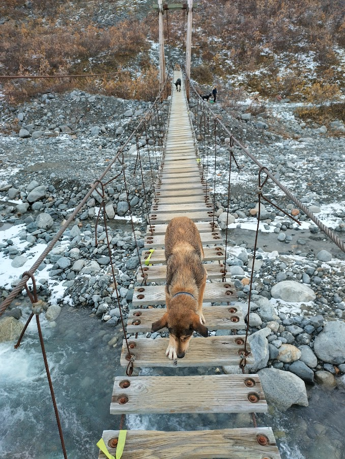

### Dolly

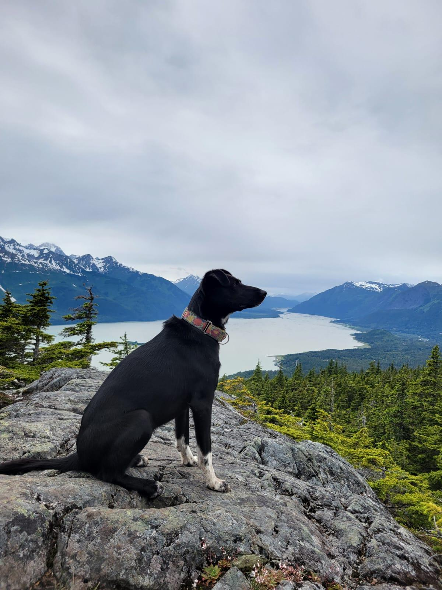

### Ember

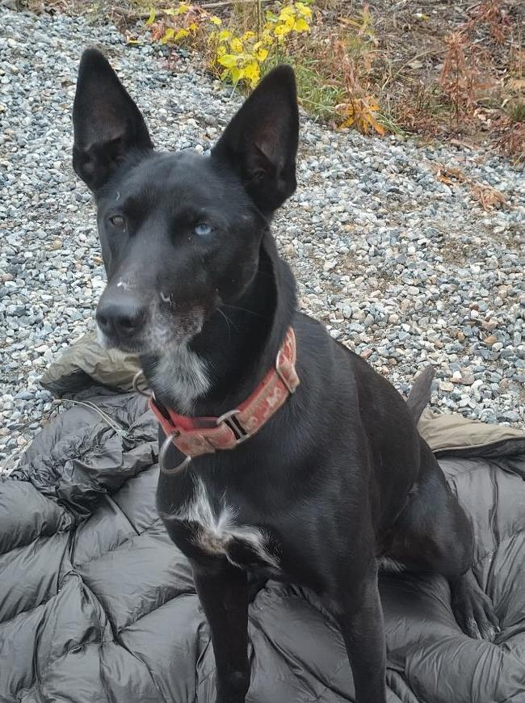

### Kyber

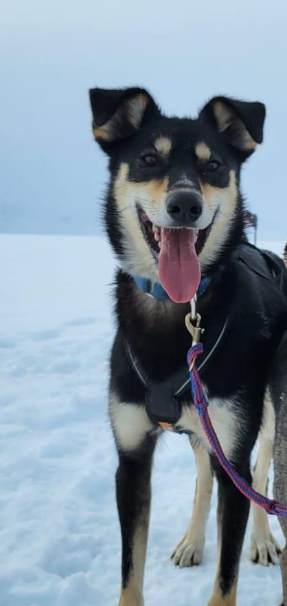

### Lexi

_Retired_

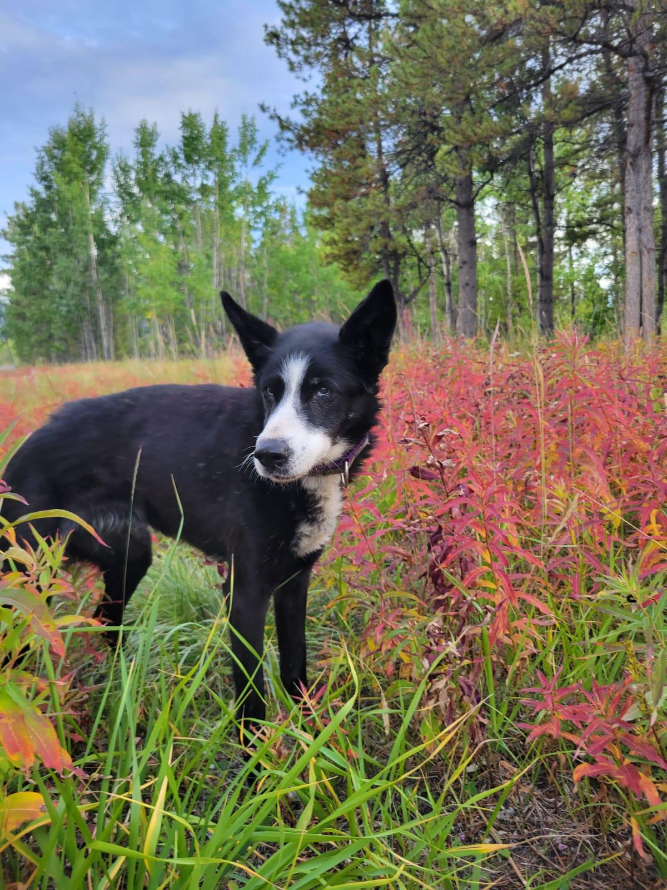

### Lizzy

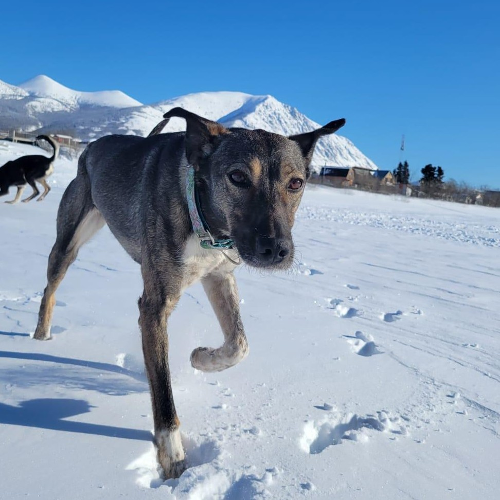

### Lulu

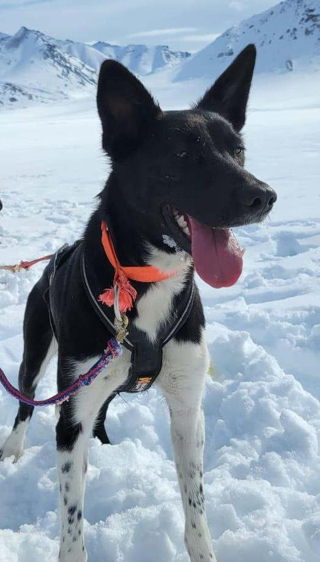

### Marlo

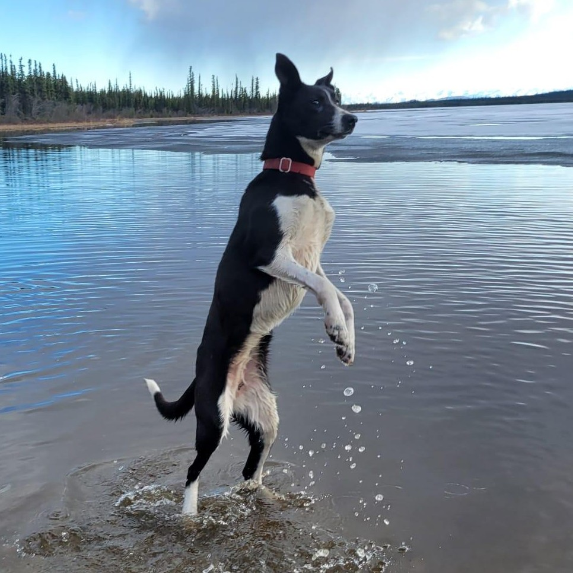

### Tiny 

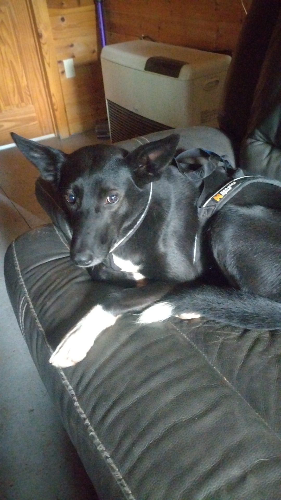

### Vicky 

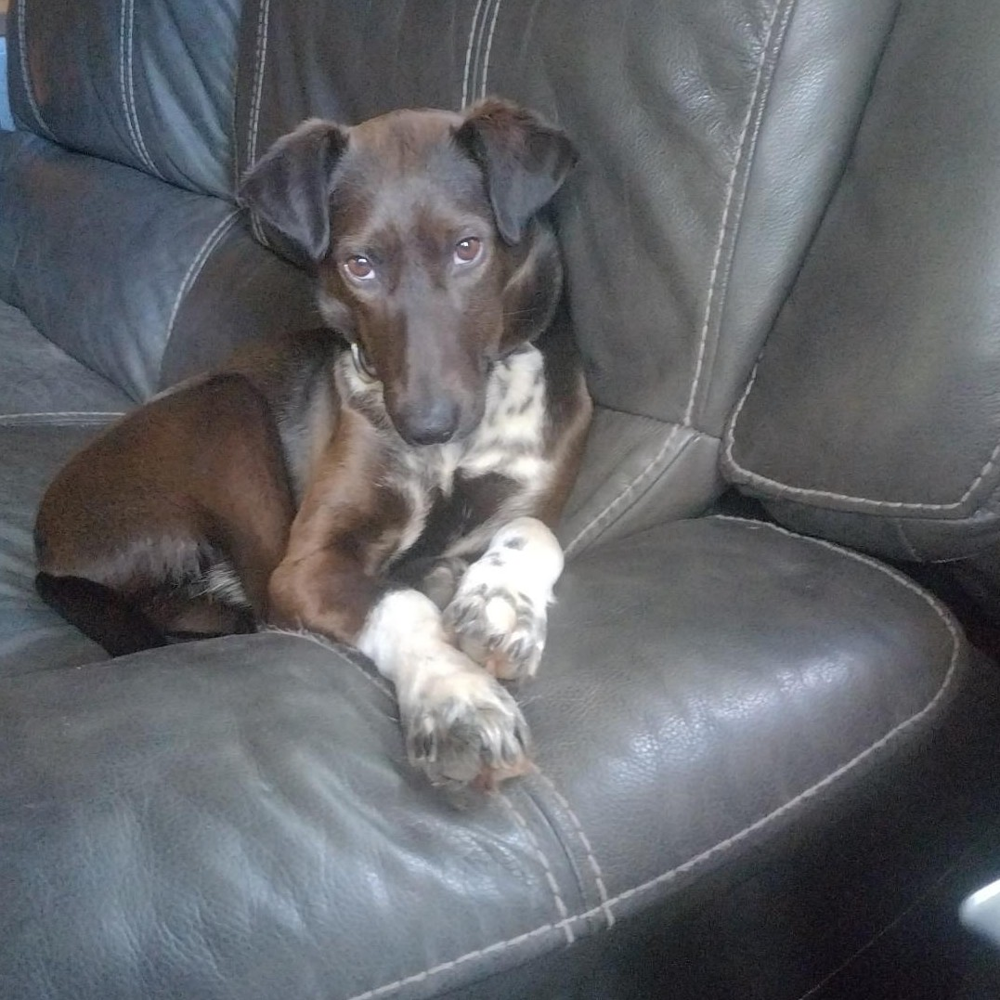

## Previous Years Results and Team

### 2025 - 2026 Season Results

* Solstice 50 - Win 1/11
* Beargrease 120 - Win (1/23, Vet's Choice, Rookie Of the Year)
* Hiawatha Heritage Dog Sled Race 80 - (2/8)
* Gunflint Mail Run 60 -  (2/11)
* DPSAY Valentine's Race - Win (1/5)
* The Percy 100 - Win (1/3)
* Copper Basin 100 - Win (1/9)

### 2024 - 2025 Season Results

Undefeated in mid-distance racing!

* Solstice 50 - Win (1/21)
* Carbon Hill 40 - Win (1/8)
* Caledonia Classic 50 - Win (1/5)
* Race to the Sky 100 - Win (1/20)
* The Pas 6 Dog
* The Pas 4 Dog
* Canadian Challenge 100 - Win (1/6)
* Yukon Odyssey 100 - Win (1/6)
* The Percy 100 - Win (1/5)
* Underdog 100 - Win (1/15)

### 2023 - 2024 Season Results

* ACE Race Doubles (100k) - Win
* Solstice 50 - Win
* Yukon Quest Canada 100 (km not miles due to weather) - Win
* Babe Southwick 10 Dog - 6/9
* Fur Rondy - 11/13
* T-Dog 50 - Win 
* TRDMA Valley Funale 20 - Win (Maisie driving the team!)

### Flecha

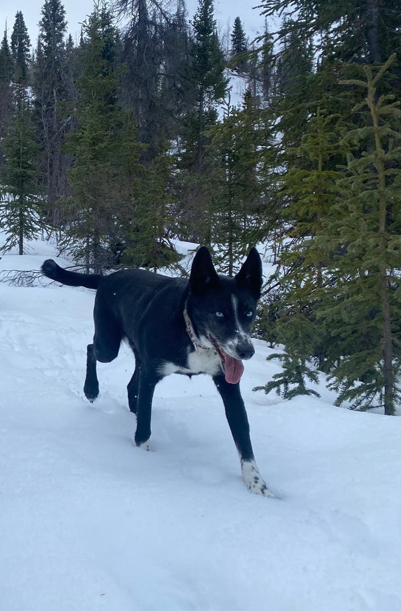

### Comet

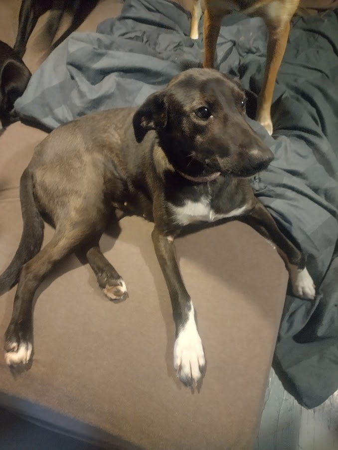

### Jenne

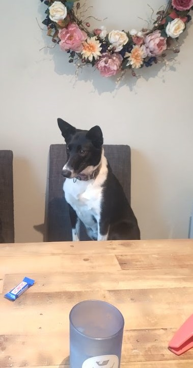

## Contact

seandewolski@duck.com
